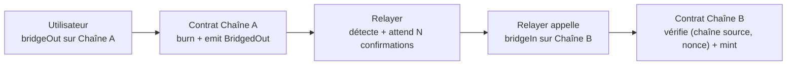

# Mini-Bridge EVM

Bridge **mint & burn** d'un token ERC20 entre deux testnets EVM publics : **Sepolia** ↔ **Base Sepolia**.

Un utilisateur brûle ses tokens sur la chaîne source avec `bridgeOut`. Un relayer off-chain détecte l'event, attend N confirmations, puis appelle `bridgeIn` sur la chaîne destination pour minter le même montant.



## Déploiements

| Chaîne | Contrat `BridgeToken` | Supply initiale |
| --- | --- | --- |
| Sepolia (11155111) | [`0xfC726086E18893840c68ab5aBc11a8Fd0AC38c36`](https://sepolia.etherscan.io/address/0xfC726086E18893840c68ab5aBc11a8Fd0AC38c36) | 1 000 000 BRT |
| Base Sepolia (84532) | [`0x6e75b742ab49219ECECf4aD0c8aBF1428b93b60b`](https://sepolia.basescan.org/address/0x6e75b742ab49219ECECf4aD0c8aBF1428b93b60b) | 0 (mint via bridge uniquement) |

Relayer : [`0x7Bb2F6363807a3daf266E7E824cC17Ba3526DEF9`](https://sepolia.etherscan.io/address/0x7Bb2F6363807a3daf266E7E824cC17Ba3526DEF9) · Owner : `0xfb068f29Bb99A76a03Db9E4F3f23628E203dAf6f`

### Transferts vérifiables

| # | Sens | Montant | Burn (source) | Mint (destination) | Délai |
| --- | --- | --- | --- | --- | --- |
| 1 | Sepolia → Base Sepolia | 10 BRT | [`0x5559…57d7`](https://sepolia.etherscan.io/tx/0x5559808b5f022c2c8bcfe1cd75c9d15ae194952c7372fe79fe72f9a8896557d7) | [`0x4710…b3d4`](https://sepolia.basescan.org/tx/0x471010818c2f95e26c0726dd4026fd989be7636294a4fcaec1bb879cb543b3d4) | 64 s |
| 2 | Base Sepolia → Sepolia | 4 BRT | [`0x34be…2579`](https://sepolia.basescan.org/tx/0x34bee53f5542bf9aadc77859a1920538d80133592c1ddcf04306161f4d2c2579) | [`0x6190…16c3`](https://sepolia.etherscan.io/tx/0x61900c1e3e388d9b20f92d1596908867b938b9a7c6d2144ae832e96a759a16c3) | 28 s |
| 3 | Sepolia → Base Sepolia, **relayer arrêté pendant le burn** | 5 BRT | [`0x4911…809f`](https://sepolia.etherscan.io/tx/0x49111f9d086089a4d69d13a3f7de2ee0f13f09140ad0d6d317a10136b0f0809f) | [`0xf5ed…d6f8`](https://sepolia.basescan.org/tx/0xf5ed3680de20ba55884feb2554b53776dbb3a5531a0b5e1950e7d933c5d9d6f8) | 89 s (dont l'arrêt) |

Après ces trois transferts : 999 989 BRT sur Sepolia + 11 BRT sur Base Sepolia = 1 000 000, la supply initiale. On compte exactement un event `BridgedIn` par burn (2 sur Base Sepolia, 1 sur Sepolia), donc aucun double mint.

La spécification complète (architecture, sécurité, risques) est dans [`docs/SPEC.md`](docs/SPEC.md).

## État d'avancement

| Étape | Statut |
| --- | --- |
| 1. Setup (repo, Hardhat, wallets) | ✅ |
| 2. Smart contract `BridgeToken` + tests | ✅ déployé sur Sepolia et Base Sepolia |
| 3. Relayer v1 | ✅ testé en local sur deux nœuds Hardhat |
| 4. Robustesse (SQLite, rattrapage, reprise) | ✅ en local ; à valider sur les testnets |
| 5. Démo & doc | ⏳ |

## Structure

```
contracts/BridgeToken.sol    ERC20 + bridgeOut / bridgeIn / contrôle d'accès
test/BridgeToken.test.js     tests unitaires (Hardhat + Chai)
scripts/generate-wallets.js  génère les wallets deployer et relayer dans .env
scripts/deploy.js            déploie et écrit deployments/<réseau>.json
relayer/relayer.js           boucle du relayer : scan des BridgedOut, puis bridgeIn
relayer/db.js                base SQLite (opérations + curseur de bloc par chaîne)
relayer/index.js             point d'entrée (lit deployments/*.json et .env)
relayer/test/                test d'intégration sur deux nœuds Hardhat locaux
docs/SPEC.md                 document de conception
```

## Lancer le projet

```bash
npm install
npm test                 # tests du contrat
npm run test:relayer     # test d'intégration du relayer (deux chaînes locales, ~5 s)
npm run wallets          # crée .env avec deux wallets dédiés (affiche uniquement les adresses)
```

Alimenter le deployer en ETH de test sur Sepolia (faucet), puis répartir avec `scripts/fund.js` :

```bash
node scripts/fund.js sepolia  # 0.01 ETH → relayer sur Sepolia + 0.02 ETH vers Base Sepolia (bridge officiel)
node scripts/fund.js base     # une fois l'ETH arrivé : 0.008 ETH → relayer sur Base Sepolia
npm run balances              # soldes des deux wallets sur les deux chaînes
```

Ensuite :

```bash
npm run deploy:sepolia        # chaîne d'origine : 1 000 000 BRT mintés à l'owner
npm run deploy:base-sepolia   # chaîne secondaire : supply 0, les tokens n'arrivent que via bridgeIn
```

Puis lancer le relayer :

```bash
npm run relayer          # tourne en continu (Ctrl+C pour l'arrêter)
npm run relayer:status   # historique des opérations en base
```

Variables optionnelles : `CONFIRMATIONS` (défaut 5), `POLL_INTERVAL_MS` (12000), `MAX_BLOCK_RANGE` (200, limite du RPC public de Base), `RELAYER_DB`.

## Relayer

À chaque tick, pour chaque chaîne :

1. **scan** : lit les `BridgedOut` entre le dernier bloc traité et `tête − N confirmations`, les enregistre en base et avance le curseur dans la même transaction SQLite ;
2. **process** : pour chaque opération ouverte, vérifie `isProcessed` sur la chaîne destination, puis appelle `bridgeIn` si besoin.

Statuts : `pending` → `submitted` → `confirmed` (ou `failed` après 5 échecs).

Le test d'intégration (`relayer/test/integration.test.js`) couvre :

- un transfert A → B qui n'est minté qu'après N confirmations ;
- le retour B → A, avec la supply totale conservée ;
- un redémarrage avec rattrapage des burns émis pendant l'arrêt, sans double mint ;
- un crash après l'envoi du mint mais avant l'écriture en base : pas de double mint ;
- un revert `AlreadyProcessed` traité comme un succès.

## Contrat

| Fonction | Accès |
| --- | --- |
| `bridgeOut(amount, destChainId, recipient)` | public : brûle et émet `BridgedOut` |
| `bridgeIn(recipient, amount, sourceChainId, nonce)` | relayer uniquement : minte une seule fois par `(sourceChainId, nonce)` |
| `isProcessed(sourceChainId, nonce)` | lecture |
| `setRelayer(address)` / `setSupportedChain(chainId, bool)` | owner uniquement |

## Limites

Projet pédagogique, pas prêt pour la production : un seul relayer (point de confiance unique), clé du relayer dans un `.env` local, pas de plafond de mint, pas d'audit. Le détail est dans la section 11 de la [spec](docs/SPEC.md#11-risques-et-limites-connues).
