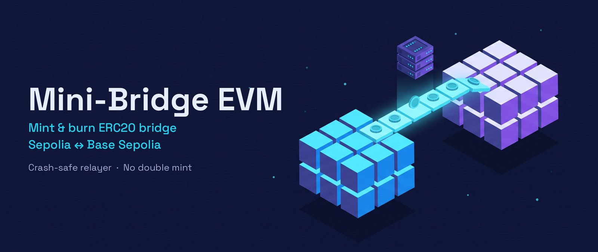
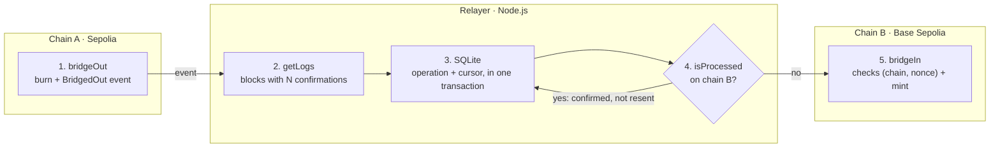

<p align="center">
  
</p>

<p align="center">
  <a href="https://github.com/RayaneChCh-dev/mini-bridge-evm/actions/workflows/ci.yml"></a>
  <a href="LICENSE"></a>
  
  
  
  
  
  
</p>

<p align="center">
  <a href="https://sepolia.etherscan.io/address/0xfC726086E18893840c68ab5aBc11a8Fd0AC38c36"></a>
  <a href="https://sepolia.basescan.org/address/0x6e75b742ab49219ECECf4aD0c8aBF1428b93b60b"></a>
  <a href="#on-chain-proof"></a>
</p>

# Mini-Bridge EVM

A **mint & burn** bridge for an ERC20 token (`BRT`) between two public EVM testnets, **Sepolia** and **Base Sepolia**, in both directions.

Tokens are burned on the source chain. An off-chain relayer waits until the burn is confirmed, then mints the same amount on the destination chain. The contract rejects any replay, and the relayer recovers from downtime or a crash without ever minting twice.

Three real transfers were made on the testnets (details [below](#on-chain-proof)), with no loss and no double mint.

## The project in one minute

[](https://cdn.jsdelivr.net/gh/RayaneChCh-dev/mini-bridge-evm@f34a5483aa79cc7172daea355bf98b4e56cf0421/docs/demo/mini-bridge-explainer.mp4)

*Click the image to play the video (1 min, with subtitles).*

Visuals generated with Higgsfield (Nano Banana Pro for the style reference, Gemini Omni for the scenes), ElevenLabs v4 voice, music "A Quiet Courtyard" by Artur Aravidi.

## Contents

- [The project in one minute](#the-project-in-one-minute)
- [Why this project](#why-this-project)
- [Architecture](#architecture)
- [Design choices](#design-choices)
- [On-chain proof](#on-chain-proof)
- [Running the project](#running-the-project)
- [Tests](#tests)
- [Limitations and possible improvements](#limitations-and-possible-improvements)
- [What I learned](#what-i-learned)

## Why this project

Two blockchains cannot talk to each other natively: moving an asset from one to the other requires an external component that watches the first chain and acts on the second.

This project reproduces a real enterprise task: a bridge between a private blockchain (EVM, Besu nodes) and Ethereum for an ERC20 stablecoin. It replaces the private chain with a second public testnet. The technical problem stays the same: burn on one side, mint on the other, and a reliable relayer in between.

## Architecture



The way back (B → A) is symmetrical: same contract on both chains, same relayer.

### The `BridgeToken` contract

A single contract ([`contracts/BridgeToken.sol`](contracts/BridgeToken.sol)), deployed identically on both chains. It is an OpenZeppelin ERC20 with:

| Function | Access | Role |
| --- | --- | --- |
| `bridgeOut(amount, destChainId, recipient)` | public | Burns the caller's tokens and emits `BridgedOut(sender, recipient, amount, sourceChainId, destChainId, nonce)` |
| `bridgeIn(recipient, amount, sourceChainId, nonce)` | relayer only | Mints, once per `(sourceChainId, nonce)` pair |
| `isProcessed(sourceChainId, nonce)` | view | Tells whether an operation has already been minted |
| `setRelayer(address)` | owner only | Changes (or revokes) the relayer |
| `setSupportedChain(chainId, bool)` | owner only | Declares the chains this contract bridges with |

The initial supply (1,000,000 BRT) only exists on Sepolia. On Base Sepolia, tokens only appear through `bridgeIn`. The sum of both supplies therefore always equals 1,000,000.

### The relayer

The relayer ([`relayer/relayer.js`](relayer/relayer.js)) runs in a loop, with one tick every 12 s. On every tick:

1. **Scan**: for each chain, it reads `BridgedOut` events between the last processed block and `head − N confirmations`. The operations found and the new cursor are written in **the same SQLite transaction**, so a crash can never move the cursor forward while losing events.
2. **Mint**: for each open operation, it checks `isProcessed` on the destination chain. If it is already minted, it marks it `confirmed` without resending. Otherwise, it calls `bridgeIn`.

Operation statuses: `pending` → `submitted` → `confirmed`, or `failed` after 5 failures. The chain is the source of truth; the local database is only working state.

## Design choices

| Choice | Risk addressed | Rejected alternative |
| --- | --- | --- |
| Mint & burn | Supply duplicated across chains | Lock & mint: useful when you don't control the original token, which is not the case here |
| `(source chainId, nonce)` identifier checked on-chain | Double mint, replay | Nonce alone: two source chains can emit the same nonce as soon as there are more than two |
| Explicit chain and recipient in `bridgeOut`, allowlist of chains | Tokens burned towards a chain no relayer serves | Implicit destination, guessed by the relayer |
| N confirmations before acting (5 by default) | Minting a burn that a chain reorganization undoes | Acting as soon as the event appears |
| `getLogs` polling in 200-block ranges | Events missed during downtime | WebSocket: no history on reconnect, often missing from free RPCs |
| `isProcessed` before every mint; an `AlreadyProcessed` revert counts as success | Crash between sending the mint and writing to the database | Trusting the database alone |
| Relayer key separate from the owner key | One compromised key grants every right | A single key: here the relayer can only mint, and the owner can revoke it |

The full design document is in [`docs/SPEC.md`](docs/SPEC.md).

## On-chain proof

| Chain | `BridgeToken` contract | Initial supply |
| --- | --- | --- |
| Sepolia (11155111) | [`0xfC726086E18893840c68ab5aBc11a8Fd0AC38c36`](https://sepolia.etherscan.io/address/0xfC726086E18893840c68ab5aBc11a8Fd0AC38c36) | 1,000,000 BRT |
| Base Sepolia (84532) | [`0x6e75b742ab49219ECECf4aD0c8aBF1428b93b60b`](https://sepolia.basescan.org/address/0x6e75b742ab49219ECECf4aD0c8aBF1428b93b60b) | 0 |

Relayer: [`0x7Bb2F6363807a3daf266E7E824cC17Ba3526DEF9`](https://sepolia.etherscan.io/address/0x7Bb2F6363807a3daf266E7E824cC17Ba3526DEF9) · Owner: `0xfb068f29Bb99A76a03Db9E4F3f23628E203dAf6f`

| # | Direction | Amount | Burn (source) | Mint (destination) | Delay |
| --- | --- | --- | --- | --- | --- |
| 1 | Sepolia → Base Sepolia | 10 BRT | [`0x5559…57d7`](https://sepolia.etherscan.io/tx/0x5559808b5f022c2c8bcfe1cd75c9d15ae194952c7372fe79fe72f9a8896557d7) | [`0x4710…b3d4`](https://sepolia.basescan.org/tx/0x471010818c2f95e26c0726dd4026fd989be7636294a4fcaec1bb879cb543b3d4) | 64 s |
| 2 | Base Sepolia → Sepolia | 4 BRT | [`0x34be…2579`](https://sepolia.basescan.org/tx/0x34bee53f5542bf9aadc77859a1920538d80133592c1ddcf04306161f4d2c2579) | [`0x6190…16c3`](https://sepolia.etherscan.io/tx/0x61900c1e3e388d9b20f92d1596908867b938b9a7c6d2144ae832e96a759a16c3) | 28 s |
| 3 | Sepolia → Base Sepolia, **relayer stopped during the burn** | 5 BRT | [`0x4911…809f`](https://sepolia.etherscan.io/tx/0x49111f9d086089a4d69d13a3f7de2ee0f13f09140ad0d6d317a10136b0f0809f) | [`0xf5ed…d6f8`](https://sepolia.basescan.org/tx/0xf5ed3680de20ba55884feb2554b53776dbb3a5531a0b5e1950e7d933c5d9d6f8) | 89 s, downtime included |

Result: 999,989 BRT on Sepolia + 11 BRT on Base Sepolia = 1,000,000, the initial supply. There is exactly one `BridgedIn` event per burn: no double mint. The way back is faster because Base produces a block every 2 s, versus 12 s on Sepolia.

## Running the project

Requirements: Node.js 22 or later.

```bash
npm install
npm test                 # contract tests
npm run test:relayer     # relayer integration test on two local chains
```

### On the testnets

```bash
npm run wallets               # creates .env with two dedicated wallets (prints addresses only)
```

Fund the deployer address with test ETH on Sepolia from a faucet, then split it:

```bash
node scripts/fund.js sepolia  # 0.01 ETH to the relayer on Sepolia + 0.02 ETH to Base Sepolia (Base's official bridge)
node scripts/fund.js base     # once the ETH has arrived (about 5 min): 0.008 ETH to the relayer on Base Sepolia
npm run balances              # balances of both wallets on both chains
```

Deploy, then run the relayer and make a transfer:

```bash
npm run deploy:sepolia        # 1,000,000 BRT minted to the owner, Base Sepolia allowed
npm run deploy:base-sepolia   # supply 0, Sepolia allowed

npm run relayer               # terminal 1: runs continuously (Ctrl+C to stop)
npm run bridge -- sepolia 10  # terminal 2: 10 BRT from Sepolia to Base Sepolia
npm run bridge                # BRT balances on both chains
npm run relayer:status        # operation history from the database
npm run trace -- <txHash>     # burn ↔ mint on both chains, explorer links, total supply (read-only)
```

Optional relayer environment variables: `CONFIRMATIONS` (default 5), `POLL_INTERVAL_MS` (12000), `MAX_BLOCK_RANGE` (200, the limit of Base's public RPC), `RELAYER_DB`, `SEPOLIA_RPC_URL`, `BASE_SEPOLIA_RPC_URL`.

### Layout

```
contracts/BridgeToken.sol         ERC20 + bridgeOut / bridgeIn / access control
test/BridgeToken.test.js          contract unit tests
relayer/relayer.js                relayer loop: scan BridgedOut events, then bridgeIn
relayer/db.js                     SQLite database (operations + block cursor per chain)
relayer/index.js                  entry point (reads deployments/*.json and .env)
relayer/test/integration.test.js  integration test on two local Hardhat nodes
scripts/                          wallets, funding, deployment, transfers, tracing
deployments/                      addresses and deployment blocks per network
docs/SPEC.md                      design document
docs/demo/                        explainer video
docs/banner.jpg                   README banner (Higgsfield, Nano Banana Pro)
.github/workflows/ci.yml          CI: contract + relayer tests on every push
```

## Tests

**Contract** (`npm test`, 13 tests): burn and mint, increasing nonce, replay rejected, same nonce accepted from two different chains, `bridgeIn` rejected for any address other than the relayer (owner included), unsupported chains, relayer change.

**Relayer** (`npm run test:relayer`, 5 scenarios, about 4 s): the test starts two Hardhat nodes itself, with different chainIds (31337 and 31338), and checks:

- an A → B transfer minted only after N confirmations;
- the way back B → A, with the total supply preserved;
- a restart that catches up on burns made during downtime, without double minting;
- a crash after sending the mint but before writing to the database: no double mint;
- an `AlreadyProcessed` revert treated as a success.

## Limitations and possible improvements

This project is an educational demo, **not a production-ready solution**.

| Limitation | Improvement |
| --- | --- |
| A single relayer: single point of trust and failure | Validation by several signers (M of N), or an existing cross-chain messaging network (Chainlink CCIP, LayerZero, Hyperlane) |
| Relayer key in a local `.env` | HSM or KMS; owner behind a multisig |
| No mint cap: a stolen key can mint without limit | Per-period cap, emergency pause |
| A stuck mint transaction is never replaced | Resend with higher fees and account nonce management |
| Fixed 5 confirmations | Wait for each chain's actual finality |
| No audit, no monitoring | External audit; alerts on stuck operations and on supply drift between chains |

In the real Besu ↔ Ethereum case, the private chain running QBFT consensus has immediate finality, and the bridge validators can be distinct internal entities.

## What I learned

- **ethers v6 caches identical RPC responses for 250 ms**: two back-to-back transactions were sent with the same account nonce. The integration test caught it; the fix is `cacheTimeout: -1`.
- **Public RPCs have their own limits**: `sepolia.base.org` rejects `eth_getLogs` requests over 200 blocks, with a 413 error whose real cause only appears in the response body.
- **The chain must stay the source of truth**: the local database can lag behind after a crash, hence the `isProcessed` check before every mint.

## License

MIT
