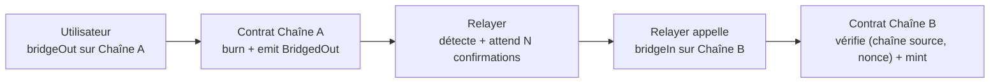

# Mini-Bridge EVM

Bridge **mint & burn** d'un token ERC20 entre deux testnets EVM publics : **Sepolia** ↔ **Base Sepolia**.

Un utilisateur brûle ses tokens sur la chaîne source avec `bridgeOut`. Un relayer off-chain détecte l'event, attend N confirmations, puis appelle `bridgeIn` sur la chaîne destination pour minter le même montant.



La spécification complète (architecture, sécurité, risques) est dans [`docs/SPEC.md`](docs/SPEC.md).

## État d'avancement

| Étape | Statut |
| --- | --- |
| 1. Setup (repo, Hardhat, wallets) | ✅ |
| 2. Smart contract `BridgeToken` + tests | ✅ contrat et tests ; déploiement testnet en attente des faucets |
| 3. Relayer v1 | ⏳ |
| 4. Robustesse (SQLite, rattrapage, reprise) | ⏳ |
| 5. Démo & doc | ⏳ |

## Structure

```
contracts/BridgeToken.sol    ERC20 + bridgeOut / bridgeIn / contrôle d'accès
test/BridgeToken.test.js     tests unitaires (Hardhat + Chai)
scripts/generate-wallets.js  génère les wallets deployer et relayer dans .env
scripts/deploy.js            déploie et écrit deployments/<réseau>.json
relayer/                     service relayer (étape 3)
docs/SPEC.md                 document de conception
```

## Lancer le projet

```bash
npm install
npm test                 # tests du contrat
npm run wallets          # crée .env avec deux wallets dédiés (affiche uniquement les adresses)
```

Alimenter les deux adresses affichées en ETH de test sur Sepolia et Base Sepolia, puis :

```bash
npm run deploy:sepolia        # chaîne d'origine : 1 000 000 BRT mintés à l'owner
npm run deploy:base-sepolia   # chaîne secondaire : supply 0, les tokens n'arrivent que via bridgeIn
```

## Contrat

| Fonction | Accès |
| --- | --- |
| `bridgeOut(amount, destChainId, recipient)` | public : brûle et émet `BridgedOut` |
| `bridgeIn(recipient, amount, sourceChainId, nonce)` | relayer uniquement : minte une seule fois par `(sourceChainId, nonce)` |
| `isProcessed(sourceChainId, nonce)` | lecture |
| `setRelayer(address)` / `setSupportedChain(chainId, bool)` | owner uniquement |

## Limites

Projet pédagogique, pas prêt pour la production : un seul relayer (point de confiance unique), clé du relayer dans un `.env` local, pas de plafond de mint, pas d'audit. Le détail est dans la section 11 de la [spec](docs/SPEC.md#11-risques-et-limites-connues).
