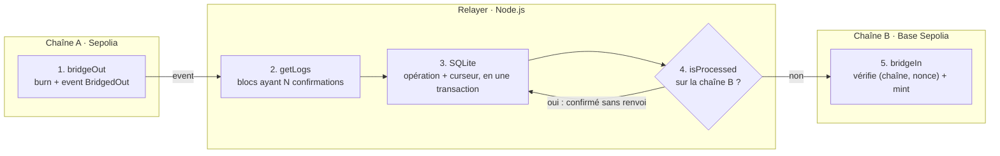

# Mini-Bridge EVM

Bridge **mint & burn** d'un token ERC20 (`BRT`) entre deux testnets EVM publics, **Sepolia** et **Base Sepolia**, dans les deux sens.

Les tokens sont brûlés sur la chaîne source. Un relayer off-chain attend que le burn soit confirmé, puis minte le même montant sur la chaîne destination. Le contrat refuse tout rejeu, et le relayer reprend après un arrêt ou un crash sans jamais minter deux fois.

Trois transferts réels ont été faits sur les testnets (détail [plus bas](#preuves-on-chain)), sans perte ni double mint.

## Sommaire

- [Pourquoi ce projet](#pourquoi-ce-projet)
- [Architecture](#architecture)
- [Choix techniques](#choix-techniques)
- [Preuves on-chain](#preuves-on-chain)
- [Lancer le projet](#lancer-le-projet)
- [Tests](#tests)
- [Limites et améliorations possibles](#limites-et-améliorations-possibles)
- [Ce que le projet m'a appris](#ce-que-le-projet-ma-appris)

## Pourquoi ce projet

Deux blockchains ne communiquent pas nativement : pour faire passer un actif de l'une à l'autre, il faut un composant extérieur qui observe la première et agit sur la seconde.

Le projet reproduit une mission réelle d'entreprise, un bridge entre une blockchain privée (EVM, nœuds Besu) et Ethereum pour un stablecoin ERC20. Il remplace la chaîne privée par un second testnet public. Le problème technique reste le même : burn d'un côté, mint de l'autre, et un relayer fiable entre les deux.

## Architecture



Le sens retour (B → A) est symétrique : même contrat sur les deux chaînes, même relayer.

### Le contrat `BridgeToken`

Un seul contrat ([`contracts/BridgeToken.sol`](contracts/BridgeToken.sol)), déployé à l'identique sur les deux chaînes. C'est un ERC20 OpenZeppelin avec :

| Fonction | Accès | Rôle |
| --- | --- | --- |
| `bridgeOut(amount, destChainId, recipient)` | public | Brûle les tokens de l'appelant et émet `BridgedOut(sender, recipient, amount, sourceChainId, destChainId, nonce)` |
| `bridgeIn(recipient, amount, sourceChainId, nonce)` | relayer uniquement | Minte, une seule fois par couple `(sourceChainId, nonce)` |
| `isProcessed(sourceChainId, nonce)` | lecture | Indique si une opération a déjà été mintée |
| `setRelayer(address)` | owner uniquement | Change (ou révoque) le relayer |
| `setSupportedChain(chainId, bool)` | owner uniquement | Déclare les chaînes avec lesquelles le contrat échange |

La supply initiale (1 000 000 BRT) n'existe que sur Sepolia. Sur Base Sepolia, les tokens n'apparaissent que par `bridgeIn`. Ainsi, la somme des deux supplies reste toujours égale à 1 000 000.

### Le relayer

Le relayer ([`relayer/relayer.js`](relayer/relayer.js)) tourne en boucle, avec un tick toutes les 12 s. À chaque tick :

1. **Lecture** : pour chaque chaîne, il lit les events `BridgedOut` entre le dernier bloc traité et `tête − N confirmations`. Les opérations trouvées et le nouveau curseur sont écrits dans **la même transaction SQLite**. Un crash ne peut donc pas faire avancer le curseur en perdant des events.
2. **Mint** : pour chaque opération ouverte, il vérifie `isProcessed` sur la chaîne destination. Si elle est déjà mintée, il la marque `confirmed` sans renvoyer. Sinon, il appelle `bridgeIn`.

Statuts d'une opération : `pending` → `submitted` → `confirmed`, ou `failed` après 5 échecs. La chaîne est la source de vérité ; la base locale n'est qu'un état de travail.

## Choix techniques

| Choix | Risque traité | Alternative écartée |
| --- | --- | --- |
| Mint & burn | Supply dupliquée entre les chaînes | Lock & mint : utile quand on ne contrôle pas le token d'origine, ce qui n'est pas le cas ici |
| Identifiant `(chainId source, nonce)` vérifié on-chain | Double mint, rejeu | Nonce seul : deux chaînes sources peuvent émettre le même nonce dès qu'il y en a plus de deux |
| Chaîne et destinataire explicites dans `bridgeOut`, liste de chaînes autorisées | Tokens brûlés vers une chaîne qu'aucun relayer ne sert | Destination implicite, devinée par le relayer |
| N confirmations avant d'agir (5 par défaut) | Mint d'un burn annulé par une réorganisation de chaîne | Agir dès l'event |
| Polling `getLogs` par plages de 200 blocs | Events manqués pendant un arrêt | WebSocket : pas d'historique à la reconnexion, souvent absent des RPC gratuits |
| `isProcessed` avant chaque mint ; revert `AlreadyProcessed` traité comme un succès | Crash entre l'envoi du mint et l'écriture en base | Se fier à la base seule |
| Clé du relayer distincte de l'owner | Une clé compromise donne tous les droits | Une clé unique : ici le relayer ne peut que minter, et l'owner peut le révoquer |

Le document de conception complet est dans [`docs/SPEC.md`](docs/SPEC.md).

## Preuves on-chain

| Chaîne | Contrat `BridgeToken` | Supply initiale |
| --- | --- | --- |
| Sepolia (11155111) | [`0xfC726086E18893840c68ab5aBc11a8Fd0AC38c36`](https://sepolia.etherscan.io/address/0xfC726086E18893840c68ab5aBc11a8Fd0AC38c36) | 1 000 000 BRT |
| Base Sepolia (84532) | [`0x6e75b742ab49219ECECf4aD0c8aBF1428b93b60b`](https://sepolia.basescan.org/address/0x6e75b742ab49219ECECf4aD0c8aBF1428b93b60b) | 0 |

Relayer : [`0x7Bb2F6363807a3daf266E7E824cC17Ba3526DEF9`](https://sepolia.etherscan.io/address/0x7Bb2F6363807a3daf266E7E824cC17Ba3526DEF9) · Owner : `0xfb068f29Bb99A76a03Db9E4F3f23628E203dAf6f`

| # | Sens | Montant | Burn (source) | Mint (destination) | Délai |
| --- | --- | --- | --- | --- | --- |
| 1 | Sepolia → Base Sepolia | 10 BRT | [`0x5559…57d7`](https://sepolia.etherscan.io/tx/0x5559808b5f022c2c8bcfe1cd75c9d15ae194952c7372fe79fe72f9a8896557d7) | [`0x4710…b3d4`](https://sepolia.basescan.org/tx/0x471010818c2f95e26c0726dd4026fd989be7636294a4fcaec1bb879cb543b3d4) | 64 s |
| 2 | Base Sepolia → Sepolia | 4 BRT | [`0x34be…2579`](https://sepolia.basescan.org/tx/0x34bee53f5542bf9aadc77859a1920538d80133592c1ddcf04306161f4d2c2579) | [`0x6190…16c3`](https://sepolia.etherscan.io/tx/0x61900c1e3e388d9b20f92d1596908867b938b9a7c6d2144ae832e96a759a16c3) | 28 s |
| 3 | Sepolia → Base Sepolia, **relayer arrêté pendant le burn** | 5 BRT | [`0x4911…809f`](https://sepolia.etherscan.io/tx/0x49111f9d086089a4d69d13a3f7de2ee0f13f09140ad0d6d317a10136b0f0809f) | [`0xf5ed…d6f8`](https://sepolia.basescan.org/tx/0xf5ed3680de20ba55884feb2554b53776dbb3a5531a0b5e1950e7d933c5d9d6f8) | 89 s, arrêt compris |

Bilan : 999 989 BRT sur Sepolia + 11 BRT sur Base Sepolia = 1 000 000, la supply initiale. On compte exactement un event `BridgedIn` par burn : aucun double mint. Le retour est plus rapide car Base produit un bloc toutes les 2 s, contre 12 s pour Sepolia.

## Lancer le projet

Prérequis : Node.js 22 ou plus.

```bash
npm install
npm test                 # tests du contrat
npm run test:relayer     # test d'intégration du relayer sur deux chaînes locales
```

### Sur les testnets

```bash
npm run wallets               # crée .env avec deux wallets dédiés (n'affiche que les adresses)
```

Alimenter l'adresse du deployer en ETH de test sur Sepolia avec un faucet, puis répartir :

```bash
node scripts/fund.js sepolia  # 0.01 ETH au relayer sur Sepolia + 0.02 ETH vers Base Sepolia (bridge officiel de Base)
node scripts/fund.js base     # une fois l'ETH arrivé (environ 5 min) : 0.008 ETH au relayer sur Base Sepolia
npm run balances              # soldes des deux wallets sur les deux chaînes
```

Déployer, puis lancer le relayer et faire un transfert :

```bash
npm run deploy:sepolia        # 1 000 000 BRT mintés à l'owner, Base Sepolia autorisée
npm run deploy:base-sepolia   # supply 0, Sepolia autorisée

npm run relayer               # terminal 1 : tourne en continu (Ctrl+C pour l'arrêter)
npm run bridge -- sepolia 10  # terminal 2 : 10 BRT de Sepolia vers Base Sepolia
npm run bridge                # soldes BRT sur les deux chaînes
npm run relayer:status        # historique des opérations en base
```

Variables d'environnement optionnelles du relayer : `CONFIRMATIONS` (défaut 5), `POLL_INTERVAL_MS` (12000), `MAX_BLOCK_RANGE` (200, limite du RPC public de Base), `RELAYER_DB`, `SEPOLIA_RPC_URL`, `BASE_SEPOLIA_RPC_URL`.

### Structure

```
contracts/BridgeToken.sol         ERC20 + bridgeOut / bridgeIn / contrôle d'accès
test/BridgeToken.test.js          tests unitaires du contrat
relayer/relayer.js                boucle du relayer : lecture des BridgedOut, puis bridgeIn
relayer/db.js                     base SQLite (opérations + curseur de bloc par chaîne)
relayer/index.js                  point d'entrée (lit deployments/*.json et .env)
relayer/test/integration.test.js  test d'intégration sur deux nœuds Hardhat locaux
scripts/                          wallets, financement, déploiement, transferts
deployments/                      adresses et blocs de déploiement par réseau
docs/SPEC.md                      document de conception
```

## Tests

**Contrat** (`npm test`, 13 tests) : burn et mint, nonce croissant, rejeu refusé, même nonce accepté depuis deux chaînes différentes, appel de `bridgeIn` refusé pour toute adresse autre que le relayer (owner compris), chaînes non autorisées, changement de relayer.

**Relayer** (`npm run test:relayer`, 5 scénarios, environ 4 s) : le test lance lui-même deux nœuds Hardhat avec des chainIds différents (31337 et 31338) et vérifie :

- un transfert A → B minté seulement après N confirmations ;
- le retour B → A, avec la supply totale conservée ;
- un redémarrage qui rattrape les burns faits pendant l'arrêt, sans double mint ;
- un crash après l'envoi du mint mais avant l'écriture en base : pas de double mint ;
- un revert `AlreadyProcessed` traité comme un succès.

## Limites et améliorations possibles

Ce projet est une démonstration pédagogique, **pas une solution prête pour la production**.

| Limite | Amélioration |
| --- | --- |
| Un seul relayer : point de confiance et de défaillance unique | Validation par plusieurs signataires (M sur N), ou une messagerie inter-chaînes existante (Chainlink CCIP, LayerZero, Hyperlane) |
| Clé du relayer dans un `.env` local | HSM ou KMS ; owner en multisig |
| Aucun plafond de mint : une clé volée permet de minter sans limite | Plafond par période, pause d'urgence |
| Transaction de mint bloquée jamais remplacée | Renvoi avec des frais plus élevés et gestion des nonces de compte |
| 5 confirmations fixes | Attendre la finalité réelle de chaque chaîne |
| Pas d'audit ni de monitoring | Audit externe ; alertes sur les opérations bloquées et sur l'écart de supply entre les chaînes |

Dans le cas réel Besu ↔ Ethereum, la chaîne privée en consensus QBFT a une finalité immédiate, et les validateurs du bridge peuvent être des entités internes distinctes.

## Ce que le projet m'a appris

- **Le cache d'ethers v6** garde 250 ms les réponses RPC identiques : deux transactions enchaînées partaient avec le même nonce de compte. Le test d'intégration l'a révélé ; c'est corrigé avec `cacheTimeout: -1`.
- **Les RPC publics ont leurs propres limites** : `sepolia.base.org` refuse les `eth_getLogs` de plus de 200 blocs, avec une erreur 413 dont la vraie cause n'apparaît que dans le corps de la réponse.
- **La chaîne doit rester la source de vérité** : la base locale peut être en retard après un crash, d'où la vérification `isProcessed` avant chaque mint.

## Licence

MIT
