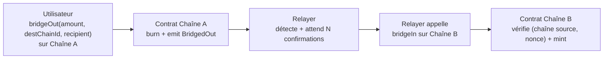

# Mini-Bridge EVM : Bridge Mint & Burn entre deux testnets

22 octobre 2026 · Rayane Achouchi

Ce projet personnel consiste à construire un **mini-bridge mint & burn** entre deux blockchains EVM publiques (testnets), permettant de transférer un token ERC20 de l'une à l'autre. L'objectif est double : acquérir une compréhension pratique des mécanismes de pont inter-chaînes (un sujet central dans l'industrie crypto/entreprise), et produire une démonstration concrète et vérifiable à présenter en entretien.

## 1. Contexte et objectifs

L'idée vient d'un échange avec un ami travaillant dans une BU Crypto & Blockchain, qui m'a partagé un exemple de mission confiée en interne : construire un bridge entre une blockchain privée d'entreprise (EVM, nodes Besu) et un testnet Ethereum public, pour faire transiter un stablecoin ERC20 entre les deux via un mécanisme mint & burn.

N'ayant pas accès à l'infrastructure privée de l'entreprise, ce projet reproduit le même problème technique sur deux testnets EVM publics et gratuits, dans le but de :

- Comprendre concrètement comment deux blockchains qui ne communiquent pas nativement peuvent échanger de la valeur
- Monter en compétence sur Solidity, les standards ERC20, et les patterns de bridge
- Produire un projet démontrable (repo + démo) pour un entretien dans le secteur crypto/blockchain

Expérience préalable mobilisée : lancement d'un token sur Solana (memecoin), bots Telegram lisant des transactions on-chain via Helius, notions de testnet/devnet/mainnet acquises lors d'un hackathon sur Aleo.

## 2. Périmètre

**Inclus**

- Déploiement d'un contrat ERC20 avec mint/burn sur deux testnets EVM
- Service relayer off-chain qui écoute les events de burn et déclenche le mint sur l'autre chaîne
- Protection anti-rejeu (identifiant `(chaîne source, nonce)`) et attente de confirmations de blocs
- Petit historique local des opérations de bridge (statut en attente / confirmé / échoué)
- Démo vérifiable (transactions visibles sur les explorateurs publics)

**Hors périmètre**

- Bridge multi-signature ou décentralisé (un seul relayer, pas de réseau de validateurs)
- Interface utilisateur poussée (un CLI ou une page minimale suffit)
- Audit de sécurité formel du contrat
- Déploiement en production / mainnet

## 3. Architecture générale

Le pattern retenu est **mint & burn** : les tokens sont brûlés sur la chaîne source et un montant équivalent est minté sur la chaîne destination. Un seul composant off-chain, le **relayer**, fait le lien entre les deux chaînes.

Points clés de cette architecture :

- Le relayer est le **seul** composant à détenir une clé ayant le droit de mint (voir section 6)
- Chaque opération est identifiée par le couple **(chainId source, nonce)** : le nonce est un compteur propre à chaque chaîne source, et le couple reste unique même si l'on ajoute d'autres chaînes. Le contrat destination refuse tout couple déjà traité (anti-rejeu)
- L'utilisateur choisit explicitement la **chaîne de destination** et le **destinataire** ; le contrat refuse une chaîne de destination non déclarée, pour éviter de brûler des tokens vers une chaîne qu'aucun relayer ne sert
- Le relayer attend un nombre de confirmations de blocs avant d'agir, pour éviter de réagir à un event qui serait annulé par une réorganisation de chaîne
- L'opération n'est pas parfaitement atomique : si le relayer échoue entre la détection et le mint, il doit pouvoir reprendre sans dupliquer (sections 5 et 11)

## 4. Smart contract : BridgeToken

Un seul contrat `BridgeToken.sol`, déployé à l'identique sur les deux chaînes. Standard **ERC20** (via OpenZeppelin) étendu avec :

| Fonction | Rôle | Accès |
| --- | --- | --- |
| `bridgeOut(uint256 amount, uint256 destChainId, address recipient)` | Brûle les tokens de l'appelant, émet `BridgedOut(sender, recipient, amount, sourceChainId, destChainId, nonce)` | Public |
| `bridgeIn(address recipient, uint256 amount, uint256 sourceChainId, uint256 nonce)` | Minte vers `recipient` après avoir vérifié que `(sourceChainId, nonce)` n'a pas déjà été traité | Réservé au relayer (`onlyRelayer`) |
| `isProcessed(uint256 sourceChainId, uint256 nonce)` | Indique si une opération a déjà été mintée (utilisé par le relayer à la reprise) | Lecture publique |
| `setRelayer(address newRelayer)` | Change l'adresse autorisée à appeler `bridgeIn` | Réservé à l'owner |
| `setSupportedChain(uint256 chainId, bool supported)` | Déclare les chaînes avec lesquelles le contrat échange | Réservé à l'owner |

Le mapping `processed[keccak256(sourceChainId, nonce)]` garde trace des opérations déjà traitées pour empêcher tout rejeu. La supply initiale n'est mintée que sur la chaîne d'origine ; sur l'autre chaîne, les tokens n'existent que via `bridgeIn`.

Tests unitaires Hardhat/Chai : mint/burn normal, tentative de rejeu d'un même `(chaîne, nonce)`, même nonce venant de deux chaînes différentes (doit passer), appel de `bridgeIn` par une adresse non autorisée — owner compris (doit échouer), chaîne non supportée, changement de relayer.

## 5. Service relayer (off-chain)

Service Node.js (`ethers.js`) tournant en continu, avec quatre responsabilités :

1. **Écoute** : souscription aux events `BridgedOut` sur la chaîne source (WebSocket), avec un polling `getLogs` régulier en secours
2. **Rattrapage** : le relayer enregistre en base le **dernier bloc traité** pour chaque chaîne. Au démarrage, il relit avec `getLogs` tous les blocs depuis ce point, pour récupérer les events émis pendant qu'il était arrêté (une souscription WebSocket ne renvoie pas l'historique)
3. **Confirmation** : attente d'un nombre fixe de blocs (ex. 5-10) avant de considérer l'event comme définitif
4. **Action** : appel de `bridgeIn` sur la chaîne destination avec la clé du relayer, puis mise à jour du statut en base locale

État persisté dans une base SQLite :

- table `bridge_operations` : clé primaire `(source_chain_id, nonce)`, chaîne destination, destinataire, montant, statut, hash de la transaction source, hash de la transaction de mint
- table `cursors` : dernier bloc traité par chaîne

Au démarrage, le service reprend les opérations restées « en attente ». Avant de renvoyer un mint, il vérifie `isProcessed(sourceChainId, nonce)` sur la chaîne destination : si le relayer a planté **après** l'envoi du mint mais **avant** la mise à jour de la base, l'opération est déjà mintée et doit simplement être passée en « confirmé ». De même, un revert `AlreadyProcessed` est traité comme un succès, pas comme une erreur.

## 6. Sécurité et gestion des clés

Le point le plus sensible du projet : la clé du relayer a le droit de mint sur la chaîne destination. Si elle fuite, un attaquant peut minter des tokens à l'infini.

**Mesures retenues pour ce projet de démo :**

- Clé dédiée au relayer, distincte de l'owner/admin du contrat (séparation des privilèges) ; l'owner lui-même ne peut pas appeler `bridgeIn`
- Stockée en variable d'environnement locale (`.env`, jamais commité, permissions `600`), pas de wallet personnel
- Le contrat limite cette clé à la seule fonction `bridgeIn` (pas de droit d'administration) ; l'owner peut la révoquer via `setRelayer`

**Limites assumées (à documenter explicitement, pas à cacher) :**

- Pas de HSM ni de solution de garde multi-signature (hors périmètre d'un projet de démo gratuit)
- Pas de plafond de mint par période (rate limit) : ce serait la première protection à ajouter contre une clé compromise
- Le relayer est un point de défaillance et de confiance unique
- Ces limites seraient à traiter en priorité avant tout passage en production réelle

## 7. Infrastructure

**Chaînes retenues** : **Sepolia** (testnet Ethereum, chainId 11155111) et **Base Sepolia** (chainId 84532).

**Accès RPC** : endpoints publics gratuits (RPC publics communautaires, ou Infura/Alchemy en offre gratuite), sans engagement ni contrat — le projet a un budget nul.

**Comptes de test** : deux wallets dédiés générés pour le projet (owner/deployer et relayer), jamais un wallet personnel, financés via les faucets publics de chaque testnet.

**Hébergement du relayer** : exécution locale pendant le développement et la démo ; pas besoin d'hébergement permanent pour ce projet non productif.

## 8. Stack technique

| Brique | Outil |
| --- | --- |
| Smart contracts | Solidity 0.8.24 + OpenZeppelin 5 (ERC20, Ownable) |
| Framework de dev | Hardhat |
| Relayer | Node.js + ethers.js v6 |
| Base locale du relayer | SQLite |
| Tests | Hardhat/Chai (contrats) ; test d'intégration du relayer sur deux nœuds Hardhat locaux avec des chainIds différents |
| Wallets | Wallets dédiés générés par script (importables dans MetaMask) |
| Explorateurs | Etherscan Sepolia, BaseScan Sepolia |
| Versioning | Git / GitHub (repo public) |

## 9. Plan de livraison et jalons

Environ 8 à 12 sessions de travail (~2-3 h chacune), étalées sur 2 à 3 semaines en parallèle de l'alternance.

| Étape | Contenu | Sessions estimées |
| --- | --- | --- |
| 1. Setup | Repo, Hardhat, wallets de test, faucets des deux testnets | 1 |
| 2. Smart contract | Écriture de BridgeToken (mint/burn/contrôle d'accès), tests, déploiement sur les deux chaînes | 2-3 |
| 3. Relayer v1 | Écoute des events, confirmations de blocs, appel du mint (version simple) | 2-3 |
| 4. Robustesse | Persistance SQLite, rattrapage des blocs manqués, reprise sans double mint, retry, test d'intégration | 1-2 |
| 5. Démo & doc | README avec schéma, vidéo de démo, section limites | 1 |

## 10. Livrables attendus

- **Repo GitHub** public avec le contrat `BridgeToken.sol`, le service relayer, les tests, et un README servant de document d'architecture (structure, choix techniques, instructions de lancement)
- **Schéma du flux** (voir section 3), intégré au README
- **Démo filmée** (30-60 s) d'un bridge réussi entre les deux testnets, avec les transactions visibles sur les explorateurs publics
- **Section « Limites & améliorations possibles »** dans le README (voir section 11)

## 11. Risques et limites connues

| Risque | Impact | Atténuation dans ce projet |
| --- | --- | --- |
| Clé du relayer compromise | Mint illimité sur la chaîne destination | Clé dédiée, droits limités à `bridgeIn`, jamais commitée, révocable par l'owner |
| Crash du relayer entre burn et mint | L'utilisateur a brûlé ses tokens sans rien recevoir | Persistance SQLite + reprise automatique au démarrage |
| Crash du relayer après l'envoi du mint, avant la mise à jour de la base | Tentative de double mint à la reprise | Vérification `isProcessed` avant renvoi ; revert `AlreadyProcessed` traité comme un succès |
| Events émis pendant un arrêt du relayer | Burn jamais relayé | Curseur du dernier bloc traité + rattrapage par `getLogs` au démarrage |
| Reorg de blocs sur la chaîne source | Mint déclenché sur un event finalement annulé | Attente de N confirmations avant action |
| Double traitement d'un même event | Double mint | Identifiant `(chaîne source, nonce)` + mapping `processed` on-chain |
| Burn vers une chaîne non servie | Tokens perdus | `bridgeOut` refuse les chaînes non déclarées via `setSupportedChain` |
| Relayer centralisé | Point de défaillance et de confiance unique | Assumé et documenté comme limite (hors périmètre d'un bridge multi-signature) |

Ce projet est une démonstration pédagogique, pas une solution prête pour la production : pas d'audit de sécurité formel, pas de garde multi-signature, pas de plafond de mint, un seul relayer sans redondance.

## 12. Critères de succès

- Un transfert de tokens de la chaîne A vers la chaîne B fonctionne de bout en bout, vérifiable sur les deux explorateurs publics
- Une tentative de rejeu d'une même opération est bien rejetée
- Le relayer reprend correctement après un arrêt/redémarrage, sans double mint et sans oublier les burns survenus pendant l'arrêt
- Le repo et le README sont assez clairs pour qu'une personne extérieure comprenne l'architecture sans explication orale
- Le projet est présentable en entretien avec une démo courte et un discours assumé sur ses limites
