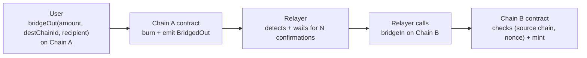

# Mini-Bridge EVM: Mint & Burn Bridge Between Two Testnets

October 22, 2026 · Rayane Achouchi

This personal project builds a **mint & burn mini-bridge** between two public EVM blockchains (testnets), allowing an ERC20 token to move from one to the other. It has two goals: gaining hands-on understanding of cross-chain bridge mechanics (a central topic in the crypto/enterprise industry), and producing a concrete, verifiable demo to present in interviews.

## 1. Context and goals

The idea came from a conversation with a friend working in a Crypto & Blockchain business unit, who shared an example of an internal task: building a bridge between a private enterprise blockchain (EVM, Besu nodes) and a public Ethereum testnet, to move an ERC20 stablecoin between the two through a mint & burn mechanism.

Without access to the company's private infrastructure, this project reproduces the same technical problem on two free public EVM testnets, in order to:

- Understand concretely how two blockchains that do not communicate natively can exchange value
- Build skills in Solidity, the ERC20 standard, and bridge patterns
- Produce a demonstrable project (repo + demo) for interviews in the crypto/blockchain sector

Prior experience drawn on: launching a token on Solana (memecoin), Telegram bots reading on-chain transactions through Helius, and testnet/devnet/mainnet concepts learned during a hackathon on Aleo.

## 2. Scope

**In scope**

- Deploying an ERC20 contract with mint/burn on two EVM testnets
- An off-chain relayer service that listens for burn events and triggers the mint on the other chain
- Replay protection (`(source chain, nonce)` identifier) and waiting for block confirmations
- A small local history of bridge operations (pending / confirmed / failed status)
- A verifiable demo (transactions visible on public block explorers)

**Out of scope**

- A multi-signature or decentralized bridge (a single relayer, no validator network)
- An elaborate user interface (a CLI or a minimal page is enough)
- A formal security audit of the contract
- Production / mainnet deployment

## 3. Overall architecture

The chosen pattern is **mint & burn**: tokens are burned on the source chain and an equivalent amount is minted on the destination chain. A single off-chain component, the **relayer**, links the two chains.

Key points of this architecture:

- The relayer is the **only** component holding a key allowed to mint (see section 6)
- Each operation is identified by the **(source chainId, nonce)** pair: the nonce is a counter specific to each source chain, and the pair stays unique even if more chains are added. The destination contract rejects any pair already processed (replay protection)
- The user explicitly chooses the **destination chain** and the **recipient**; the contract rejects an undeclared destination chain, to avoid burning tokens towards a chain no relayer serves
- The relayer waits for a number of block confirmations before acting, to avoid reacting to an event that a chain reorganization could undo
- The operation is not perfectly atomic: if the relayer fails between detection and mint, it must be able to resume without duplicating (sections 5 and 11)

## 4. Smart contract: BridgeToken

A single `BridgeToken.sol` contract, deployed identically on both chains. Standard **ERC20** (via OpenZeppelin) extended with:

| Function | Role | Access |
| --- | --- | --- |
| `bridgeOut(uint256 amount, uint256 destChainId, address recipient)` | Burns the caller's tokens, emits `BridgedOut(sender, recipient, amount, sourceChainId, destChainId, nonce)` | Public |
| `bridgeIn(address recipient, uint256 amount, uint256 sourceChainId, uint256 nonce)` | Mints to `recipient` after checking that `(sourceChainId, nonce)` has not already been processed | Relayer only (`onlyRelayer`) |
| `isProcessed(uint256 sourceChainId, uint256 nonce)` | Tells whether an operation has already been minted (used by the relayer on recovery) | Public view |
| `setRelayer(address newRelayer)` | Changes the address allowed to call `bridgeIn` | Owner only |
| `setSupportedChain(uint256 chainId, bool supported)` | Declares the chains the contract bridges with | Owner only |

The `processed[keccak256(sourceChainId, nonce)]` mapping tracks operations already processed to prevent any replay. The initial supply is minted only on the origin chain; on the other chain, tokens only exist through `bridgeIn`.

Hardhat/Chai unit tests: normal mint/burn, replay attempt of the same `(chain, nonce)`, same nonce coming from two different chains (must pass), `bridgeIn` called by an unauthorized address — owner included (must fail), unsupported chain, relayer change.

## 5. Relayer service (off-chain)

A Node.js service (`ethers.js`) running continuously, with four responsibilities:

1. **Listening**: regular polling (`getLogs`) of `BridgedOut` events on each chain, in limited block ranges (public RPCs cap the request size). Polling was preferred over a WebSocket subscription: free public RPCs do not always offer WebSockets, and a single code path handles both live tracking and catch-up
2. **Catch-up**: the relayer stores the **last processed block** for each chain in its database, in the same SQLite transaction as the operations it read. On restart, it resumes from that point and recovers the events emitted while it was down
3. **Confirmation**: only blocks with at least N confirmations (e.g. 5-10) are read, so an event is never processed before it is considered final
4. **Action**: calls `bridgeIn` on the destination chain with the relayer key, then updates the status in the local database

State persisted in a SQLite database:

- `bridge_operations` table: primary key `(source_chain_id, nonce)`, destination chain, recipient, amount, status, source transaction hash, mint transaction hash
- `cursors` table: last processed block per chain

On startup, the service resumes the operations left "pending". Before resending a mint, it checks `isProcessed(sourceChainId, nonce)` on the destination chain: if the relayer crashed **after** sending the mint but **before** updating the database, the operation is already minted and simply needs to be marked "confirmed". Likewise, an `AlreadyProcessed` revert is treated as a success, not as an error.

## 6. Security and key management

The most sensitive point of the project: the relayer key has the right to mint on the destination chain. If it leaks, an attacker can mint tokens without limit.

**Measures adopted for this demo project:**

- A key dedicated to the relayer, separate from the contract owner/admin (separation of privileges); the owner itself cannot call `bridgeIn`
- Stored in a local environment variable (`.env`, never committed, `600` permissions), not a personal wallet
- The contract restricts this key to the `bridgeIn` function only (no admin rights); the owner can revoke it through `setRelayer`

**Accepted limitations (to be documented explicitly, not hidden):**

- No HSM or multi-signature custody (out of scope for a free demo project)
- No per-period mint cap (rate limit): this would be the first protection to add against a compromised key
- The relayer is a single point of failure and trust
- These limitations would be the top priority before any real production use

## 7. Infrastructure

**Chosen chains**: **Sepolia** (Ethereum testnet, chainId 11155111) and **Base Sepolia** (chainId 84532).

**RPC access**: free public endpoints (community public RPCs, or Infura/Alchemy free tier), with no commitment or contract — the project has a zero budget.

**Test accounts**: two wallets generated for the project (owner/deployer and relayer), never a personal wallet, funded through each testnet's public faucets.

**Relayer hosting**: runs locally during development and the demo; no permanent hosting needed for this non-production project.

## 8. Tech stack

| Component | Tool |
| --- | --- |
| Smart contracts | Solidity 0.8.24 + OpenZeppelin 5 (ERC20, Ownable) |
| Development framework | Hardhat |
| Relayer | Node.js + ethers.js v6 |
| Relayer local database | SQLite |
| Tests | Hardhat/Chai (contracts); relayer integration test on two local Hardhat nodes with different chainIds |
| Wallets | Dedicated wallets generated by script (importable into MetaMask) |
| Block explorers | Etherscan Sepolia, BaseScan Sepolia |
| Versioning | Git / GitHub (public repo) |

## 9. Delivery plan and milestones

About 8 to 12 work sessions (~2-3 h each), spread over 2 to 3 weeks alongside a work-study program.

| Step | Content | Estimated sessions |
| --- | --- | --- |
| 1. Setup | Repo, Hardhat, test wallets, faucets for both testnets | 1 |
| 2. Smart contract | Writing BridgeToken (mint/burn/access control), tests, deployment on both chains | 2-3 |
| 3. Relayer v1 | Event listening, block confirmations, mint call (simple version) | 2-3 |
| 4. Robustness | SQLite persistence, catch-up on missed blocks, recovery without double mint, retry, integration test | 1-2 |
| 5. Demo & docs | README with diagram, demo video, limitations section | 1 |

## 10. Expected deliverables

- A public **GitHub repo** with the `BridgeToken.sol` contract, the relayer service, the tests, and a README serving as the architecture document (structure, technical choices, run instructions)
- A **flow diagram** (see section 3), included in the README
- A **demo video** (30-60 s) of a successful bridge between the two testnets, with transactions visible on public block explorers
- A **"Limitations and possible improvements"** section in the README (see section 11)

## 11. Risks and known limitations

| Risk | Impact | Mitigation in this project |
| --- | --- | --- |
| Relayer key compromised | Unlimited mint on the destination chain | Dedicated key, rights limited to `bridgeIn`, never committed, revocable by the owner |
| Relayer crash between burn and mint | User burned tokens and received nothing | SQLite persistence + automatic recovery on startup |
| Relayer crash after sending the mint, before updating the database | Double mint attempt on recovery | `isProcessed` check before resending; `AlreadyProcessed` revert treated as success |
| Events emitted while the relayer is down | Burn never relayed | Last-processed-block cursor + `getLogs` catch-up on startup |
| Block reorg on the source chain | Mint triggered by an event that was eventually undone | Wait for N confirmations before acting |
| Same event processed twice | Double mint | `(source chain, nonce)` identifier + on-chain `processed` mapping |
| Burn towards a chain no relayer serves | Tokens lost | `bridgeOut` rejects chains not declared through `setSupportedChain` |
| Centralized relayer | Single point of failure and trust | Accepted and documented as a limitation (multi-signature bridge out of scope) |

This project is an educational demo, not a production-ready solution: no formal security audit, no multi-signature custody, no mint cap, a single relayer with no redundancy.

## 12. Success criteria

- A token transfer from chain A to chain B works end to end, verifiable on both public block explorers
- An attempt to replay the same operation is rejected
- The relayer recovers correctly after a stop/restart, without double minting and without missing burns made during downtime
- The repo and README are clear enough for an outsider to understand the architecture without verbal explanation
- The project can be presented in an interview with a short demo and a candid discussion of its limitations
